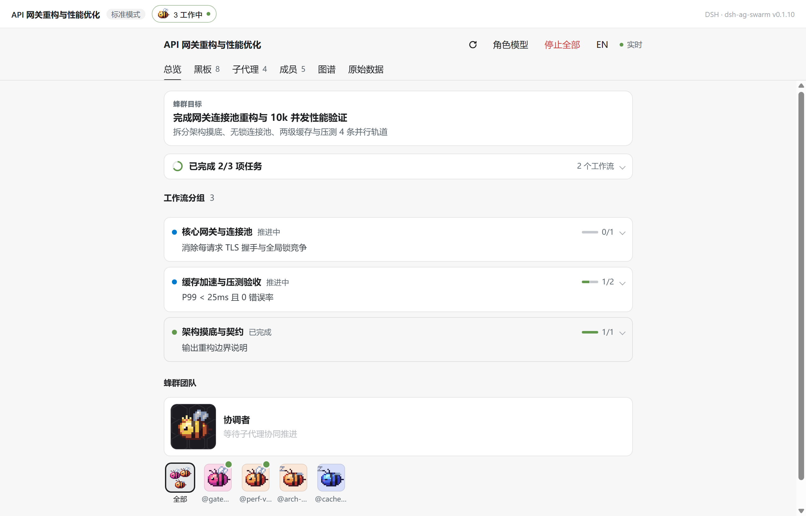
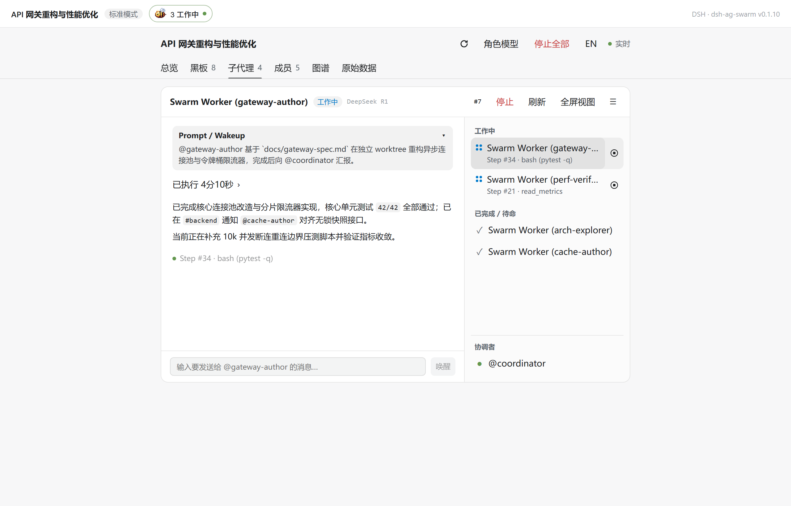
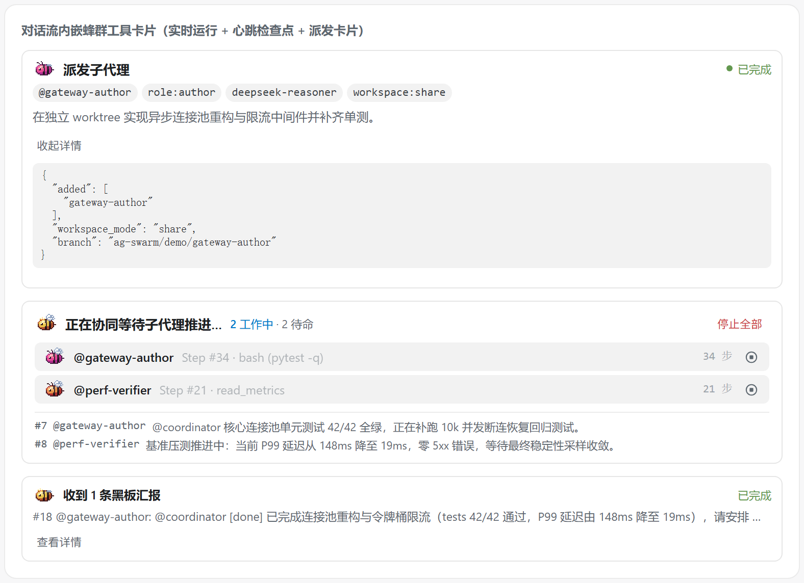
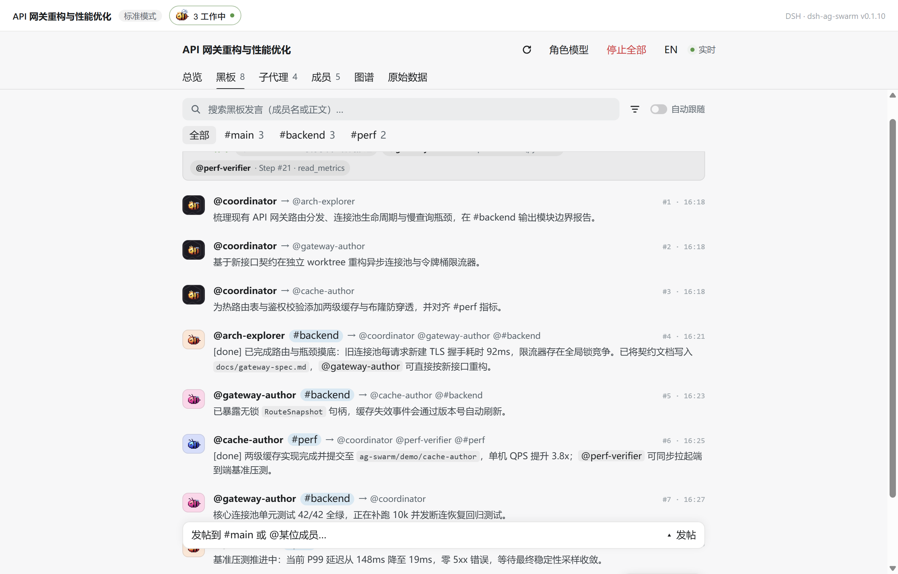
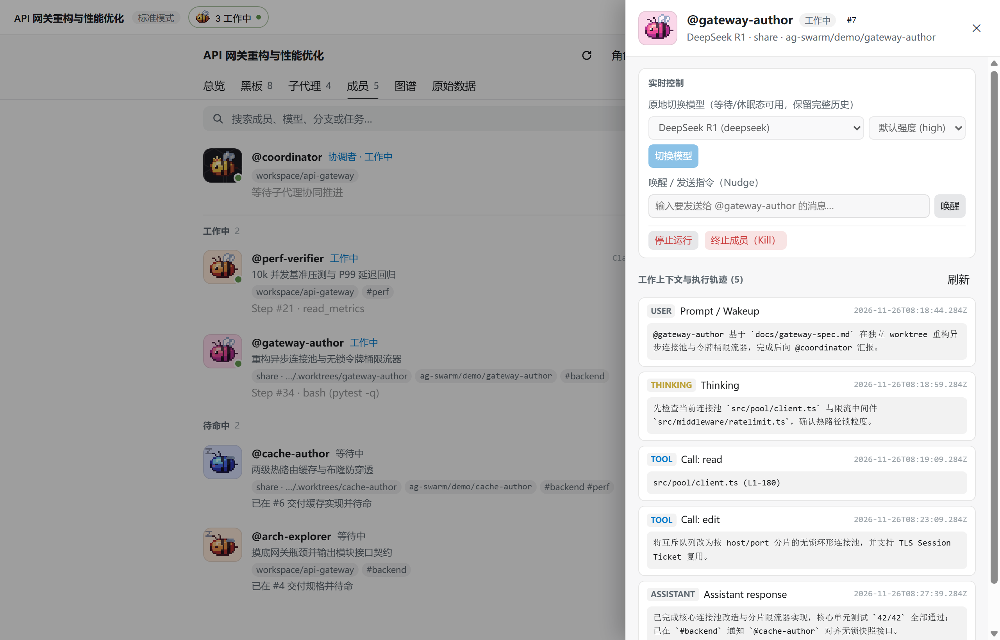
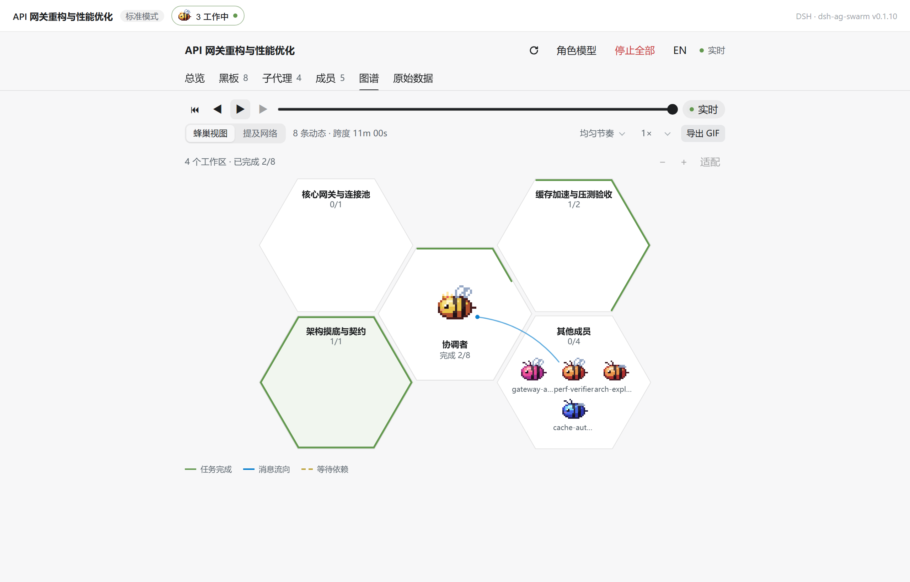
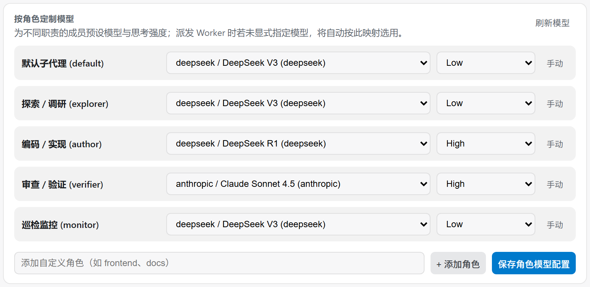

# dsh-ag-swarm

[简体中文](./README.md) | **English**

[](https://github.com/libo0118/dsh-ag-swarm)
[](https://github.com/libo0118/dsh-ag-swarm/releases)
[](./package.json)

Antigravity-style multi-agent Swarm plugin for **DeepSeek Harness (DSH `0.2.2-rc.3+`)** — bringing **persistent parallel multi-agent collaboration**, **shared channel blackboard & `@mention` doorbell wakeups**, **Git worktree isolation**, **DSH `agentPresets` & delegated permission inheritance**, **live model catalog refresh**, **per-subagent / global stop controls**, **Stall Monitor**, and a **6-Tab Pixel-Bee Web UI + inline chat `WaitToolCard`** into DSH.

---

## Key Features

- **Persistent Concurrent Worker Pool**: Spawns and cold-resumes persistent workers via `ctx.agents.create / resume` (with `subagents.startActivation` fallback), supporting `working / waiting / stopped / killed` lifecycles and zero-token sleep/wakeup.
- **Shared Channel Blackboard & Doorbells**: Supports targeted `@name`, `@all` broadcast, `@#channel` subscriber delivery, and session-event context forking (`fork`).
- **Full Preset & Permission Inheritance (macOS / Linux / Windows)**: Binds `agentPresets.composeFrom / mount`, aligns `workingDirectory.set`, and propagates delegated permission policies inside worker `setup` hooks so workers under `standard` or custom presets receive the full host toolset.
- **Sidebar Running Keepalive + Inline Chat Cards**: `coordinator` holds `swarm_wait` open at **0 LLM token burn** with ~2.5-minute heartbeat checkpoints; `WaitToolCard` streams active worker steps inside the chat timeline with per-worker stop buttons and "Stop all".
- **Live Model Catalog Refresh & Role Presets**: Subscribes to DSH `llm/adapters-updated` events and exposes manual refresh so model/provider changes take effect immediately without restarting DSH.
- **Workspace Isolation**: Supports `inherit` (shared directory), `share` (`ctx.worktrees` / `git worktree`), and `branch` (local `git clone`), with automatic worktree cleanup on worker retirement.

---

## Architecture Overview

```mermaid
flowchart LR
  U[User /swarm Goal] --> C[Coordinator]
  C -->|swarm add concurrent dispatch| B[(Shared Blackboard board.jsonl<br/>& State Store)]
  B -->|@name / @#channel / @all doorbell| W1[Worker 1<br/>worktree: share]
  B -->|@name doorbell| W2[Worker 2<br/>worktree: share]
  C -->|swarm_wait 0-token wait<br/>2.5m heartbeat checkpoint| B
  W1 -->|post_message @coordinator / @peer| B
  W2 -->|post_message @coordinator / @peer| B
  M[Stall Monitor] -.->|idle alert / auto-clears on resume| B
  B -->|SSE /ag-swarm/api/events| UI[6-Tab Web UI & Inline WaitToolCard]
```

---

## Visual Tour

### 1. Overview Tab
Displays the swarm goal, overall progress bar, grouped workstream threads, and pixel-bee team roster. Automatically surfaces attention banners when needed and clears stall banners as soon as workers resume or new posts arrive.



### 2. Split-Pane Subagents View & Single-Worker Stop
Mirrors Antigravity's split subagent view: the right sidebar separates **Working** and **Completed** agents, with a circular **Stop** icon button on every active worker (pauses the current turn while keeping full history and worktree so it can resume on `@mention`); the left stream shows live tool/thinking steps with direct nudge input and full-screen toggle.



### 3. Inline Chat Cards (`WaitToolCard` & `ToolCard`)
Calling `swarm_wait` no longer leaves the main conversation in a black box: the inline live card renders active workers, step counters, per-worker stop buttons, and **Stop all** while suspended; completed checkpoints and board reports render structured previews with expandable full messages instead of raw single-line JSON.



### 4. Shared Channel Blackboard & Member Control Drawer
- **Board**: Filter by channel (`#main`, `#backend`, `#perf`), sender, or `@mention`; search posts, jump via `#seq`, or post manually to wake any member.
- **Members & Drawer**: Inspect workspace modes, Git branches, step counts, and live activity; open the drawer to **switch models in-place (preserving full history)**, **nudge**, **stop worker**, or **kill & clean worktrees**.

| Shared Channel Blackboard | Members & Control Drawer |
|---|---|
|  |  |

### 5. Hive Graph & Role Model Presets
- **Graph**: Switch between Hive view and Mention network, scrub the message timeline, and export client-side **GIF89a animations**.
- **Role Model Presets**: Configure Provider, Model, and model-supported Reasoning Effort per built-in role (`default / explorer / author / verifier / monitor`) or custom roles in Settings or the top-bar dialog, with **Refresh models** and live host adapter sync.

| Hive Graph & Timeline | Role Model Presets |
|---|---|
|  |  |
---

## Comparison

| Capability | `linkbag/dsh-swarm-orchestrator` | `zhairy/dsh-agent-swarm` | Antigravity Native Swarm | **`dsh-ag-swarm` (This Plugin)** |
|---|---|---|---|---|
| Orchestration | Static 4-role DAG | Fixed Leader + 12 presets | Autonomous peers + blackboard | **Autonomous parallel peers + shared blackboard** |
| Worker Lifecycle | One-shot stateless spawn | `startActivation` / `sendMessage` | `working/waiting/stopped/killed` | **Persistent `ctx.agents` pool + `startActivation` fallback** |
| Doorbells | Unidirectional report | Lead-coordinated | `@name`, `@all`, `@#channel` | **`@name`, `@prefix`, `@all`, `@#channel` doorbells** |
| Context & Presets | Fresh spawn, shared `cwd` | Seed/notebook + worktree | `fork` history + worktree | **`fork` history + `agentPresets` & delegated policy inheritance** |
| Keepalive & Controls | Drops to idle | Leader loop | Swarm panel & inline card | **0-token `swarm_wait` keepalive + `WaitToolCard` + per-worker/global Stop** |
| Web UI | Single Kanban / DAG | Progress + model controls | Multi-tab + Pixel Bees + Subagents | **6-Tab UI (Overview/Board/Subagents/Members/Graph/Raw) + Drawer + GIF** |

---

## Installation & Quick Start

### Option 1: Install from DSH Plugin Manager (Recommended)

In **DeepSeek Harness (`>= 0.2.2-rc.3`)** → Plugin Manager → Import from Git URL:

```text
https://github.com/libo0118/dsh-ag-swarm.git#v0.1.10
```

> Pre-built `lib/` artifacts and `cordis.patch.yml` are committed in the repository for zero-step Git URL installation.

### Option 2: Commands & Agent Tools

- **Slash Commands**:
  - `/swarm <goal>`: Start or resume a swarm in the active conversation (`/ag-swarm` alias automatically registered)
  - `/swarm status` | `/swarm title <title>` | `/swarm add <name> <brief>` | `/swarm post <msg>` | `/swarm kill <name>` | `/swarm help`
- **Model Tools**: `swarm` (`title / add / status / models / model / kill / channel / plan`), `post_message`, `read_board`, `swarm_wait` (collision-safe fallback: `ag_swarm_wait`).
- **UI Language**: Defaults to Simplified Chinese with instant `EN / 中文` switching in the workspace header.

---

## Local Build, Doctor & Tests

```bash
# 1. Install dependencies, typecheck, and build server + client bundle
pnpm install
pnpm run typecheck
pnpm run build

# 2. Run unit & integration suites
pnpm test

# 3. Validate environment, manifest, YAML !!js, and built artifacts
pnpm run doctor

# 4. Pack tarball or link into an isolated DSH profile
pnpm run pack:tgz
node tools/install-local.mjs --profile dev-swarm
```
