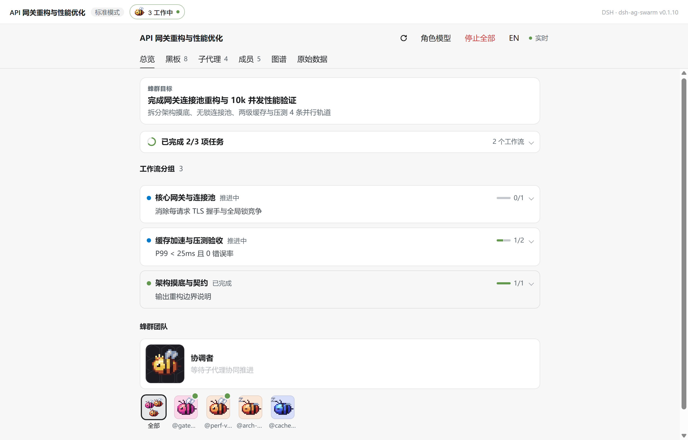
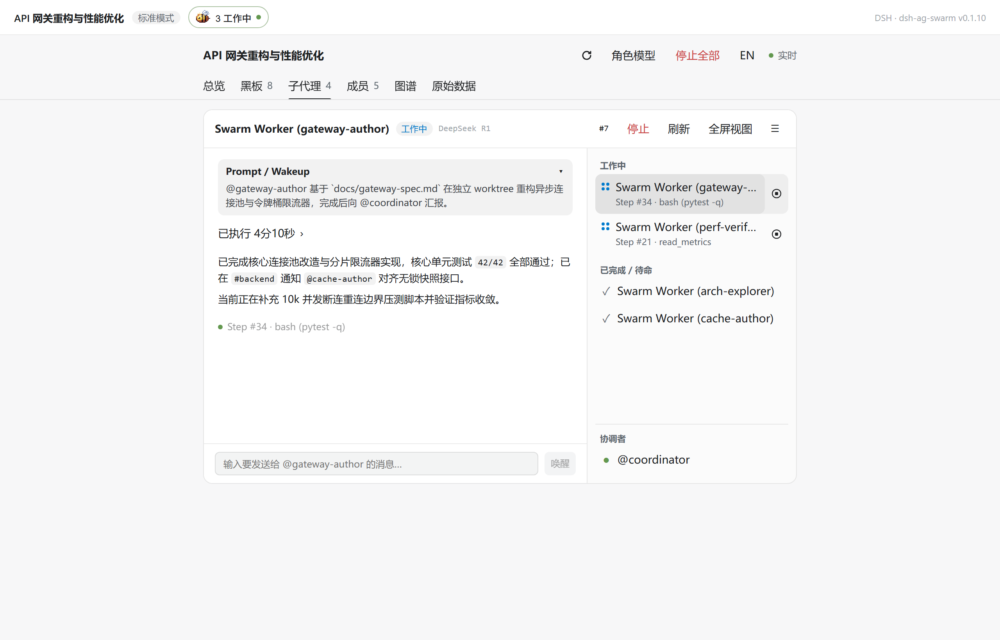
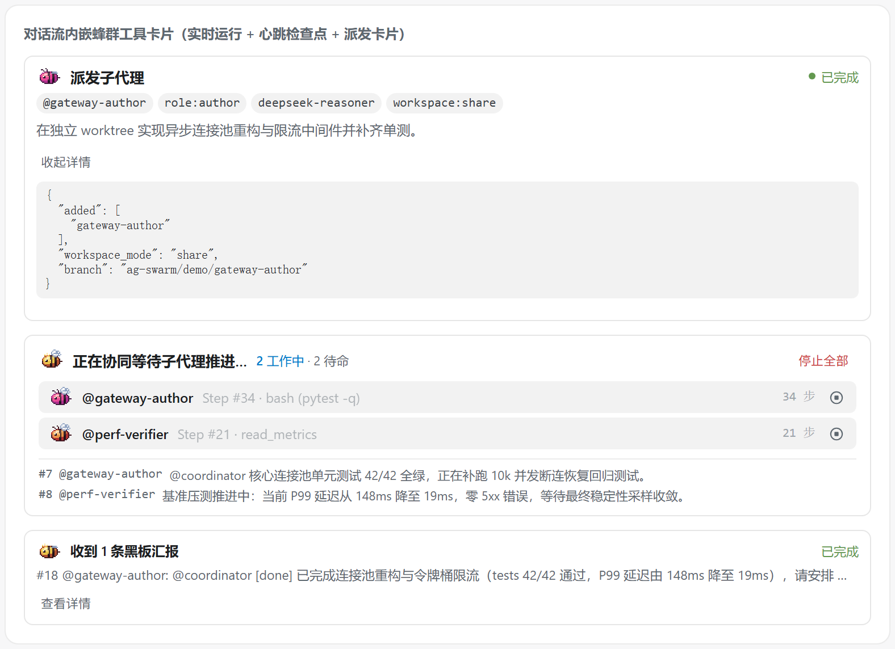
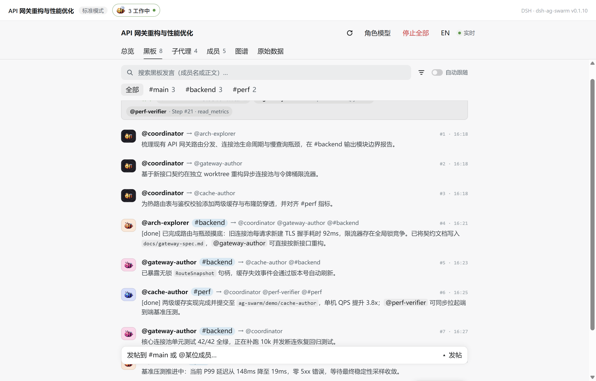
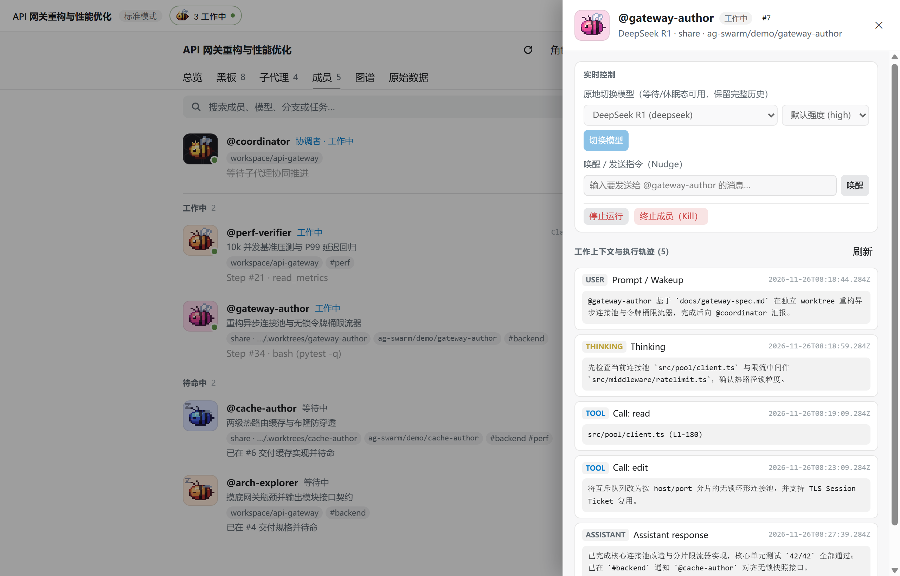
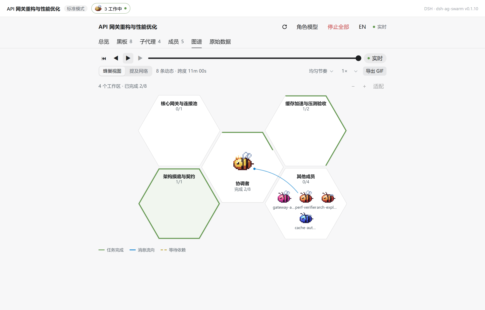
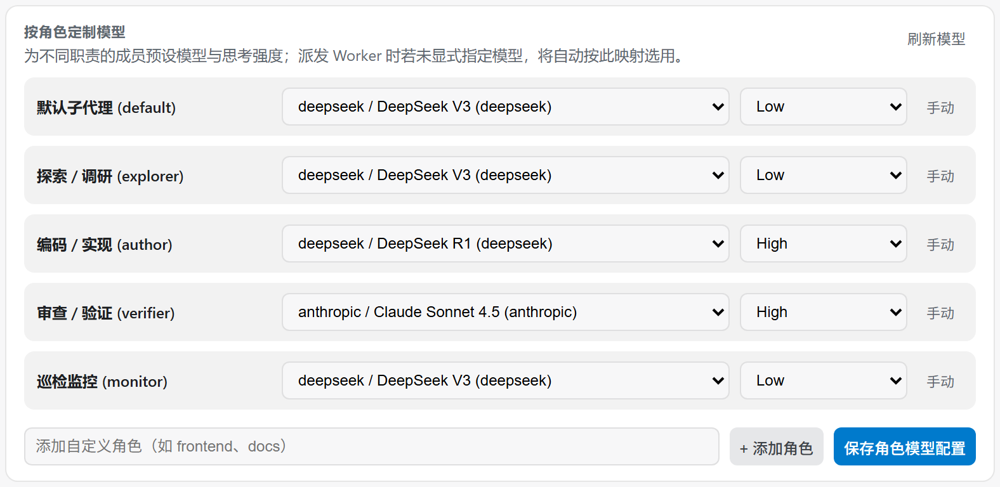

# dsh-ag-swarm

**简体中文** | [English](./README.en.md)

[](https://github.com/libo0118/dsh-ag-swarm)
[](https://github.com/libo0118/dsh-ag-swarm/releases)
[](./package.json)

面向 **DeepSeek Harness（DSH `0.2.2-rc.3+`）** 的 Antigravity 风格多智能体蜂群（Swarm）插件——在 DSH 中完整复刻并增强 **持久化并发多子代理协作**、**共享频道黑板与 `@提及` 门铃唤醒**、**Git Worktree 隔离**、**DSH 预设与权限继承**、**模型热刷新**、**单点/全局停止**、**卡顿巡检** 以及包含 **6 标签页像素蜜蜂看板与对话内嵌卡片** 的全套中文 Web UI。

---

## 核心特性一览

- **持久化并发 Worker 池**：优先通过宿主 `ctx.agents.create / resume` 创建与冷恢复子代理（失败自动回退 `subagents.startActivation`），完整支持 `working / waiting / stopped / killed` 生命周期与零成本休眠再唤醒。
- **共享黑板与门铃唤醒**：支持 `@name` 定向通知、`@all` 广播、`@#channel` 频道订阅投递，以及基于已有成员历史事件上下文分叉（`fork`）。
- **完整预设与权限继承（macOS / Linux / Windows 通用）**：在子代理 `setup` 钩子内对齐 DSH `agentPresets.composeFrom / mount`、`workingDirectory.set` 与父会话委托权限策略，确保 `standard`、`ops-ptc` 等任意模式下子代理均拥有完整工具链。
- **主会话侧边栏持续保活 + 对话内嵌进度卡片**：`coordinator` 调用 `swarm_wait` 期间以 **0 LLM Token 消耗** 挂起等待，约每 2.5 分钟返回心跳检查点汇报进度；聊天流中通过 `WaitToolCard` 实时渲染各工作中子代理的当前步骤、停顿/恢复状态及快捷停止按钮。
- **实时模型热刷新与角色模型预设**：监听 DSH `llm/adapters-updated` 事件并支持手动刷新，在插件设置或弹窗内修改模型、思考强度即可即时生效，无需重启 DSH。
- **独立 Worktree / 分支隔离**：原生支持 `inherit`（共享目录）、`share`（Git worktree 并行隔离）、`branch`（本地独立 clone）三种工作区模式，并在终止成员时自动回收临时 worktree。

---

## 协作架构与运行流程

```mermaid
flowchart LR
  U[用户 /swarm 目标] --> C[Coordinator 协调者]
  C -->|swarm add 并发派发| B[(共享黑板 board.jsonl<br/>& 状态存储)]
  B -->|@name / @#channel / @all 门铃唤醒| W1[Worker 1<br/>worktree: share]
  B -->|@name 门铃唤醒| W2[Worker 2<br/>worktree: share]
  C -->|swarm_wait 零Token挂起<br/>2.5m 心跳检查点| B
  W1 -->|post_message @coordinator / @peer| B
  W2 -->|post_message @coordinator / @peer| B
  M[Stall Monitor 卡顿巡检] -.->|空闲告警 / 恢复后自动消退| B
  B -->|SSE /ag-swarm/api/events 实时推送| UI[6-Tab Web UI & 对话 WaitToolCard]
```

---

## 界面图文介绍

### 1. 总览面板（Overview）
直观呈现蜂群总目标、整体完成进度条、各工作流分组状态、以及像素蜜蜂团队阵列；出现异常或长时间无进展时高亮提示，恢复推进后横幅自动消退。



### 2. 子代理双栏视图与单点停止（Subagents）
对齐 Antigravity 子代理交互体验：右侧实时区分「工作中」与「已完成 / 待命」列表，每个运行中的子代理均配有独立圆形 **停止** 按钮（仅暂停当前轮次，保留历史上下文与 worktree，随时可通过 `@提及` 唤醒继续）；左侧实时展示执行流并支持下方直接唤醒追问或切换全屏。



### 3. 对话内嵌工具与等待卡片（`WaitToolCard` / `ToolCard`）
主对话调用 `swarm_wait` 后不会变成“黑箱”：内嵌卡片实时展示当前工作中子代理的实时步数、正在调用的工具、单点停止按钮与「停止全部」入口；收到黑板汇报或心跳检查点时以结构化分段与全文折叠展开呈现，不再刷屏单行原始 JSON。



### 4. 共享黑板（Board）与成员控制抽屉（Members & Drawer）
- **黑板（Board）**：支持按频道（`#main` / `#backend` / `#perf`）、发送方、提及对象筛选，支持 `#序号` 定位、搜索与人工直接发帖 `@唤醒` 任意成员。
- **成员（Members）**：查看工作区模式、Git 分支、步数与实时活动；点击任一成员可打开右侧控制抽屉，执行**原地切换模型（保留完整历史）**、**唤醒发送指令（Nudge）**、**停止运行（Stop）**或**终止清理（Kill）**。

| 共享黑板 | 成员与实时控制抽屉 |
|---|---|
|  |  |

### 5. 蜂巢图谱（Graph）与按角色定制模型（Role Model Presets）
- **图谱（Graph）**：在「蜂巢视图」与「提及网络」之间切换，支持时间轴回放、倍速调节与纯前端 **GIF89a 动图导出**。
- **按角色定制模型**：在「设置 → 蜂群设置」或顶栏「角色模型」弹窗中为 `default / explorer / author / verifier / monitor` 及任意自定义角色配置 Provider、Model 与支持的思考强度；支持实时 **刷新模型**，修改宿主模型后即时生效。

| 蜂巢图谱与时间轴回放 | 按角色定制模型（热刷新） |
|---|---|
|  |  |
---

## 能力对照

| 能力维度 | Antigravity 原生 Swarm | **`dsh-ag-swarm`（本插件）** |
|---|---|---|
| 编排模式 | 自主对等协作 + 共享黑板 | **自主并行协作 + 共享频道黑板** |
| 生命周期 | `working/waiting/stopped/killed` | **持久化 `ctx.agents` 池 + `startActivation` 回退** |
| 通信唤醒 | `@name`、`@all`、`@#channel` | **`@name`、`@prefix`、`@all`、`@#channel` 门铃唤醒** |
| 上下文与预设 | `fork` 历史 + worktree 隔离 | **`fork` 历史 + `agentPresets` 完整工具与权限继承** |
| 保活与交互 | Swarm 面板与内嵌状态 | **`swarm_wait` 零 Token 保活 + `WaitToolCard` + 单点/全局停止** |
| 可视化面板 | 多标签页 + 像素蜜蜂 + 子代理视图 | **6 标签页（总览/黑板/子代理/成员/图谱/原始数据）+ 抽屉 + GIF 导出** |

---

## 快速安装与使用

### 方式一：DSH 桌面端插件管理直接安装（推荐）

在 **DeepSeek Harness (`>= 0.2.2-rc.3`)** →「插件管理」→「从 Git URL 导入」填入：

```text
https://github.com/libo0118/dsh-ag-swarm.git#v0.1.10
```

> 仓库内已提交预编译产物 `lib/` 与 `cordis.patch.yml`，安装并重启 DSH 后即可直接使用。

### 方式二：常用命令与工具

- **斜杠命令**：
  - `/swarm <目标>`：启动或继续当前会话的蜂群协作（若 `/swarm` 已被其他插件占用，自动注册 `/ag-swarm` 别名）
  - `/swarm status` | `/swarm title <标题>` | `/swarm add <成员名> <任务>` | `/swarm post <内容>` | `/swarm kill <成员名>` | `/swarm help`
- **模型可用工具**：`swarm`（`title / add / status / models / model / kill / channel / plan`）、`post_message`、`read_board`、`swarm_wait`（冲突时自动退避为 `ag_swarm_wait`）。
- **默认界面语言**：简体中文，可在蜂群面板右上角点击 `EN / 中文` 实时切换。

---

## 本地构建、自检与开发安装

```bash
# 1. 安装依赖、类型检查与全量构建（服务端 + 前端 lib/client.js）
pnpm install
pnpm run typecheck
pnpm run build

# 2. 运行单元与集成测试（黑板/投影 + 并发 Worker/Worktree/SSE/热刷新）
pnpm test

# 3. 环境、Manifest、YAML !!js 语法与构建产物自检
pnpm run doctor

# 4. 打本地分发包或挂载到指定 DSH Profile
pnpm run pack:tgz
node tools/install-local.mjs --profile dev-swarm
```
